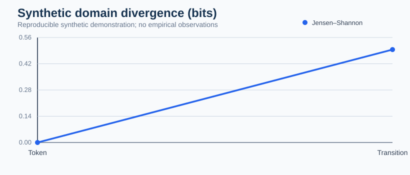
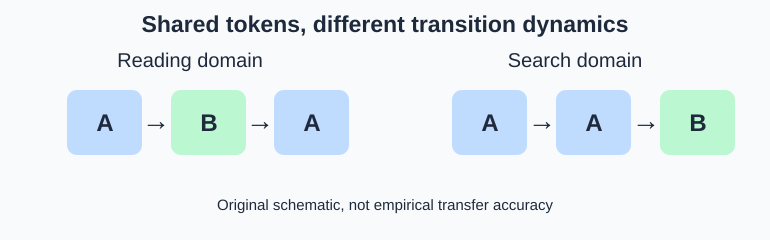
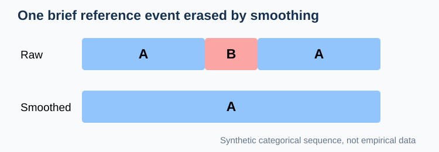

# Similar gaze tokens can hide different transition systems

**Methods briefing research implementation, 21 October 2026.**

The experimental `sequence_transfer_audit()` works on ordered categorical sequences. It compares token-frequency Jensen–Shannon divergence against transition-frequency Jensen–Shannon divergence, then evaluates a source-trained additive-smoothed first-order transition model on held-out target participants. Reports include separately trained sources, a dataset-equal probability mixture, a naive sample-frequency pooled comparator, and target-domain conditional transition entropy.

### Reproducible worked example

~~~python
import pandas as pd
from research.october_2026.sequence_transfer import sequence_transfer_audit

records = []
for domain, token_path in [("reading", ["A", "B", "A"]),
                           ("search", ["A", "A", "B"])]:
    for p in range(4):
        for step, state in enumerate(token_path):
            records.append([domain, f"{domain}-{p}", "trial", step, state])

data = pd.DataFrame(records, columns=[
    "dataset_id", "participant_id", "sequence_id", "step", "state"])
audit = sequence_transfer_audit(data)
print(audit["domain_comparisons"])
print(audit["heldout_prediction"])
~~~

The same vocabulary can have different conditional transitions. Naively pooled source models can obscure this difference. The current diagnostic compares source-equal weighting, dataset-size-weighted pooling, individually trained sources, and a target-specific comparator. These comparisons require external real-domain replication before generalization.

### Plot of the two divergence measures

~~~python
import matplotlib.pyplot as plt
row = audit["domain_comparisons"].iloc[0]
fig, ax = plt.subplots(figsize=(5, 3))
ax.bar(["Token JS", "Transition JS"],
       [row.token_js_bits, row.transition_js_bits])
ax.set_ylabel("Jensen–Shannon divergence (bits)")
ax.set_title("Synthetic domain comparison")
fig.tight_layout()
~~~

**Limitations:** A source/target split by dataset label does not by itself verify human identity independence across corpora. Sequence splitting can overstate participant generalization. The held-out target comparator in this research diagnostic is deliberately participant-disjoint, but this is not yet a validated external scanpath benchmark. Additional controls for device, task and sequence length are needed.

## Temporal smoothing and brief event loss

`smoothing_preservation.py` audits participant/trial-matched reference sequences before and after smoothing. It distinguishes sample-level error from whole-event preservation, avoiding the inference that fewer transitions necessarily mean cleaner behavior.

~~~python
import pandas as pd
from research.october_2026.smoothing_preservation import audit_smoothing_event_preservation
seq = pd.DataFrame({
    "participant_id":["P"]*7, "trial_id":["T"]*7,
    "sample_index":list(range(7)),
    "reference_label":["A","A","A","B","A","A","A"],
    "raw_label":["A","A","A","B","A","A","A"],
    "smoothed_label":["A"]*7,
})
audit = audit_smoothing_event_preservation(seq, brief_event_max_samples=1)
print(audit["brief_event_raw_retention"],audit["brief_event_smoothed_retention"])
~~~

Whole-event preservation is deliberately strict: it requires every sample of the reference interval to retain its label. This is not a substitute for duration-tolerant event matching. The example is synthetic and does not validate a specific HMM or scanpath detector.

## Publication and qualification status (21 October 2026)

This page and its original synthetic figures are merged into the GitHub documentation source. The worked research modules are under `research/october_2026/` and **are not automatically included in installed PyPI wheels or exported as stable package APIs**. Their empirical accuracy, device transfer and inferential calibration are not implied by a green CI test or a successful website build.

The explicit outstanding scientific acceptance criteria and eligible real-data benchmarks are tracked in [research-to-release issue #12](https://github.com/stefanosbalaskas/gp3sequencespy/issues/12). This source-only research contribution is separate from the existing stable package version, and a new maintenance release must not claim these experiments as installed features.
